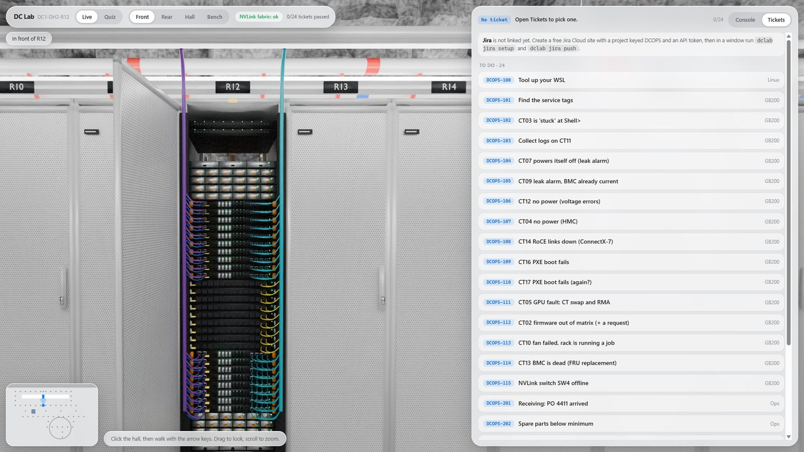

# GPU Data Center Operations Lab

**Study lab · NVIDIA GB200 NVL72 field service · RHCSA and RHCE practice**

A practice lab I built to study GPU data center work and to drill Red Hat admin skills. It teaches
a fact, gives me the job, then grades what I actually did. **Inside: 24 graded tickets, 25 work
orders on a 3D rack, and 19 RHCSA / RHCE tasks.**

The rack is simulated. The study material is the point.

## What I was studying

**GPU data center operations (GB200 NVL72)**

- **The hardware:** compute trays, NVLink switches, the busbar, leak sensors, cable cartridges, and
  where each part sits in the rack.
- **Out-of-band management:** `ipmitool`, Redfish, the serial console, and reading BMC logs.
- **Fault finding:** leak alarms, no power, PXE boot failures, RoCE links down, a GPU fault and RMA,
  a dead BMC, a switch offline, firmware that is off the site standard.
- **Hands-on procedure:** pull a tray, open it, torque the busbar, check for coolant, swap parts.
- **Running the floor:** receiving, spare parts, weak optics, power and cooling math, MTTD and MTTR,
  writing an SOP.
- **Scripting:** bash scripts that collect logs from one tray, then sweep the whole rack.

**RHCSA (11 tasks)**

- Storage on LVM, persistent mounts, finding and copying files, links.
- Users, groups, ACLs, sudo, packages, processes, a broken service.
- Bash scripts, systemd timers, SELinux, firewalld, networking, the journal.

**RHCE (8 tasks, Ansible)**

- Inventory and config, ad-hoc commands, facts, Vault, templates.
- Roles, handlers, loops and conditionals, one idempotent site playbook.

The Red Hat tasks use the same data center story (a GPU server log collector) and live in
[`rhcsa-rhce/`](rhcsa-rhce/README.md).

## How it teaches

- **Teach, do, grade:** each ticket gives the facts first, then the job, then checks the real
  result. A ticket fails if you skip a step, such as changing firmware before saving the logs.
- **Three hint levels:** `nudge`, `walk`, `show`.
- **Work orders:** read the ticket, click the right part on the 3D model, then pick the procedure.
- **Drills:** six quick modes for part names, locations, service tags and numbers.
- **Say it out loud:** `dclab speak` gives 60 seconds to explain the fix with no notes.

## Study views

**The data hall.** Walk to the rack, with two terminals next to it.


| The ticket board | A work order on the bench |
|---|---|
|  |  |

## Walkthrough

**[Four short chapters](docs/WALKTHROUGH.md)** with looping clips and steps.

## Run it

```powershell
.\START-DCLAB.ps1
```

Needs Windows 11 with WSL 2 and Ubuntu. Runs on your machine only.

```
dclab list         all 24 tickets
dclab start 104    start a ticket
dclab grade        check your work
dclab nudge        a hint (then walk, then show)
```

## What is real and what is simulated

- Commands, flags, file names and the order of work follow my notes from a GB200 NVL72
  field-service class.
- The rack, the BMCs and the Redfish service are simulators. `ezbmc` and `tech` are stand-ins.
- Firmware build numbers are placeholders, except the package and BMC build the tickets call the
  site standard.
- The pictures are path-traced renders of a scene modeled from reference photos and diagrams. Part
  names, counts and positions are right; exact dimensions are not.
- The Jira link has been tested against a local stand-in for the Jira API
  (`lab/tests/jira_mock.py`), not against a live site.
