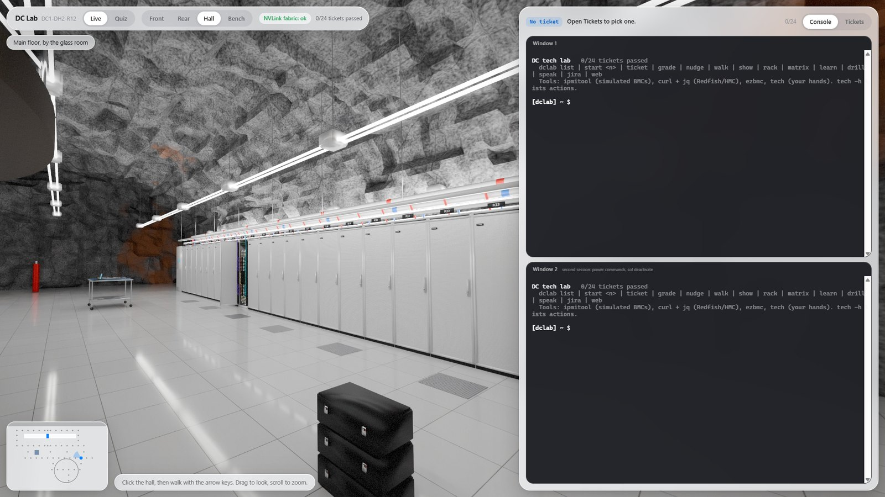
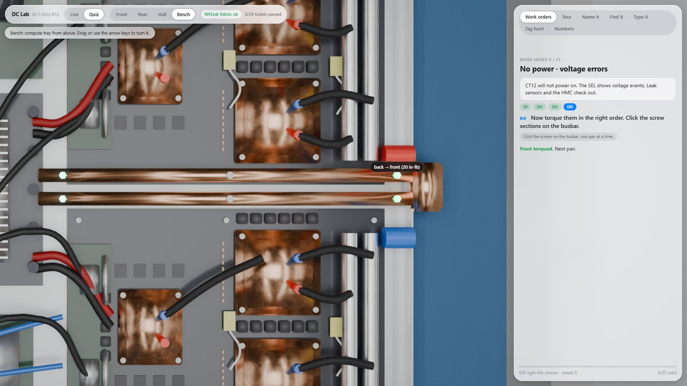

# GPU Data Center Operations Lab

**Study lab · NVIDIA GB200 NVL72 field service · RHCSA and RHCE practice**

I made this lab to learn GPU data center work and to practice Red Hat administration. Each ticket
gives the facts, gives the task, and then grades the result. **The lab has 24 graded tickets,
25 work orders, and 19 RHCSA and RHCE tasks.**

The rack is a simulation. The study material is the important part.

## What I studied

**GPU data center operations (GB200 NVL72)**

- **Hardware:** The parts of the rack and the location of each part.
- **Remote management:** `ipmitool`, Redfish, the serial console, and BMC logs.
- **Fault isolation:** Leak alarms, power faults, PXE boot faults, link faults, GPU faults, and
  incorrect firmware.
- **Hands-on procedures:** Remove a tray, open it, torque the busbar, and replace parts.
- **Floor operations:** Receiving, spare parts, power and cooling calculations, MTTD and MTTR, and
  SOPs.
- **Scripts:** Bash scripts that collect logs from one tray or from the full rack.

**RHCSA (11 tasks)**

- Storage, users and permissions, packages, processes, and services.
- Bash scripts, systemd timers, SELinux, firewalld, networks, and logs.

**RHCE (8 tasks)**

- Ansible inventory, ad hoc commands, facts, Vault, and templates.
- Roles, handlers, loops, conditions, and one site playbook.

The Red Hat tasks are in [`rhcsa-rhce/`](rhcsa-rhce/README.md).

## How the lab teaches

- **Teach, do, grade:** A ticket gives the facts, then the task. Then it examines the real result.
- **Hints:** There are three levels: `nudge`, `walk`, and `show`.
- **Work orders:** Read the ticket. Click the correct part on the 3D model. Select the procedure.
- **Drills:** Six short tests for part names, locations, service tags, and numbers.
- **Speak:** `dclab speak` gives you 60 seconds to explain the repair without notes.

## Study views

**The data hall.** Walk to the rack. Two terminals are adjacent to it.



| The ticket board | A work order on the bench |
|---|---|
|  |  |

## Walkthrough

**[Four short chapters](docs/WALKTHROUGH.md)** with video loops and steps.

## Run it

```powershell
.\START-DCLAB.ps1
```

Windows 11 with WSL 2 and Ubuntu is necessary. The lab operates only on your computer.

```
dclab list         all 24 tickets
dclab start 104    start a ticket
dclab grade        check your work
dclab nudge        a hint (then walk, then show)
```

## Real and simulated

- **Real:** The commands and the sequence of work. They come from my notes from a GB200 NVL72
  field-service class.
- **Simulated:** The rack, the BMCs, and the Redfish service.
- **Not exact:** Most firmware build numbers and the dimensions in the pictures.

This is a personal study project. It has no connection with NVIDIA, Dell, or a data center operator.
