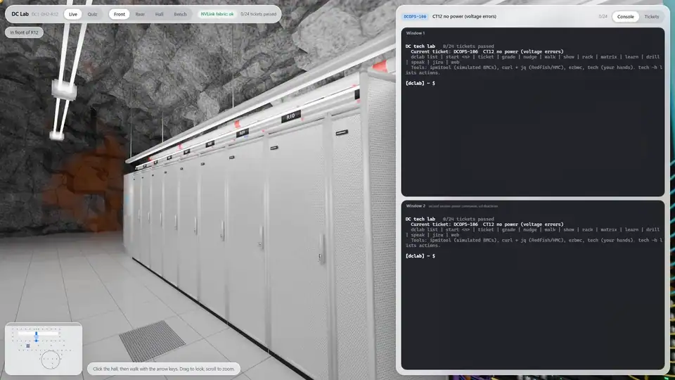
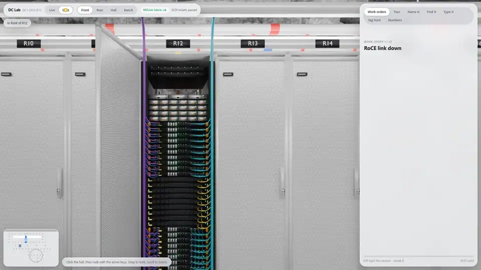

# Walkthrough

**Four short chapters · a video loop and the steps for each**

The video loops show the work at a higher speed. The steps give the real commands.

Start the lab with `.\START-DCLAB.ps1`. The user name and the password for each BMC are `admin`.
A tray is one server in the rack.

| Chapter | Summary |
|---|---|
| [1. Walk the hall](#1-walk-the-hall) | Find the rack and open the ticket list. |
| [2. A live ticket](#2-a-live-ticket) | A tray does not stay on. Find the cause and repair it. |
| [3. Bench work](#3-bench-work) | Remove a tray and torque its busbar. |
| [4. Work orders](#4-work-orders) | Click the correct part. Then select the correct repair. |

## 1. Walk the hall

**Find the rack and open the ticket list.**



1. Click the hall one time.
2. Push the Left or Right key to turn. Push the Up key to move forward.
3. Stop when the label shows **In front of R12**.
4. Open **Tickets** at the top right.
5. Click a ticket. **TEACH** gives the facts. **DO** gives the task.

## 2. A live ticket

**A tray does not stay on. Find the cause and repair it.**

This is ticket DCOPS-104. A leak sensor gives an incorrect value because the BMC firmware is old.


1. Open the ticket. Click **Start in Window 1**.
2. Go to the work folder: `dcgo`
3. Save the logs before you change the tray:

   ```
   ipmitool -I lanplus -H <BMC_IP> -U admin -P admin sdr elist | tee -a <TAG>-sdr.txt
   ipmitool -I lanplus -H <BMC_IP> -U admin -P admin sel -v list | tee -a <TAG>-sel.txt
   curl -sk -u admin:admin https://<BMC_IP>/redfish/v1/Systems/HGX_Baseboard_0/LogServices/EventLog/Entries | jq | tee -a <TAG>-HMCevents.txt
   ```

4. Find the leak sensor that is not between 1.70 V and 1.75 V.
5. Compare the BMC version with the site standard:

   ```
   curl -sk -u admin:admin https://<BMC_IP>/redfish/v1/UpdateService/FirmwareInventory/BMC_Firmware | jq .Version
   dclab matrix
   ```

6. Keep the tray off. Update the BMC: `tech fwupdate CT07 bmc 26.01.10001500`
7. In Window 2, open the serial console: `ipmitool ... sol activate`
8. In Window 1, set the power to on: `ipmitool ... chassis power on`
9. Look at the boot in Window 2. To close the console, push Enter, then type `~.`
10. Do a check of the sensors: `ipmitool ... sdr elist | grep Lea`. Each sensor shows 1.72 V.
11. Write the cause and the repair in `resolution.txt`.
12. Run `dclab grade`.

If you cannot continue, use `dclab nudge`, then `dclab walk`, then `dclab show`.

## 3. Bench work

**Remove a tray and torque its busbar.**

This is ticket DCOPS-106. The tray has no power because the busbar screws are loose. The `tech`
command does the work of your hands.


1. Start the ticket: `dclab start 106`
2. Remove the tray from the rack: `tech pull CT12`
3. Open the lid: `tech open CT12`
4. Examine the busbar: `tech inspect CT12 busbar`
5. Loosen all the screws: `tech loosen CT12 busbar`
6. Torque each section to 20 in-lb. Obey this sequence: back, front, middle.

   ```
   tech torque CT12 busbar --section back --inlb 20
   tech torque CT12 busbar --section front --inlb 20
   tech torque CT12 busbar --section middle --inlb 20
   ```

7. Look for coolant with the UV light: `tech uv CT12`
8. Close the lid: `tech close CT12`
9. Install the tray in the rack: `tech insert CT12`

To complete the ticket, save the logs, set the power to on, and run `dclab grade`. Refer to
chapter 2.

## 4. Work orders

**Click the correct part. Then select the correct repair.**

Open **Quiz**, then **Work orders**. Drag to turn the model. Scroll to change the zoom.



| Problem | Click this part | Then do this |
|---|---|---|
| No power, voltage errors | The busbar | Loosen all the screws. Torque to 20 in-lb: back, front, middle. |
| No power, HMC | The HMC board and its cable | Connect them again. |
| Leak alarm | The leak sensor | Check the BMC version. Use the UV light. Clean the sensor. |
| Tray replacement | The handles, rails, NVMe drives, and M.2 | Move them to the new tray. Send the swap form. |
| NVLink switch offline | The switch | Reset the spare switch. Install it. Let it configure itself. |
| Cable cartridge | The cartridge label at the rear | Read the NVIDIA serial number. |

The lab has 25 work orders and six drill modes.
