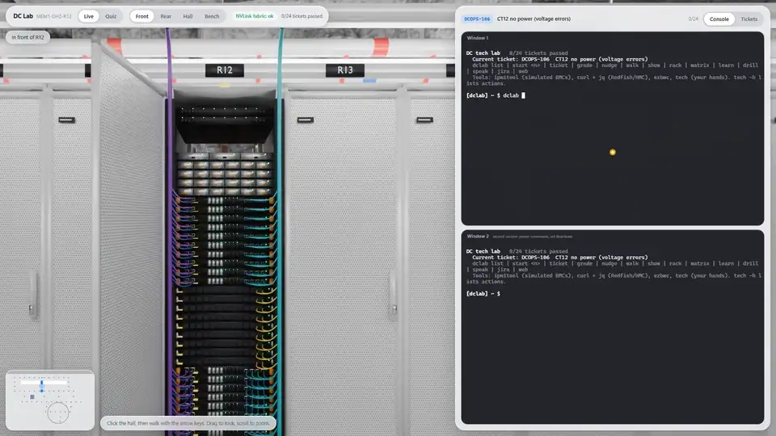

# Walkthrough

Four short chapters, in the order you would meet them on a first day. Each one has a silent loop of
the lab doing the work, and the steps written out underneath so you can follow along at your own
pace. The loops are sped up; the steps are the real commands.

Start the lab first: `.\START-DCLAB.ps1`. Every BMC is `admin` / `admin`.

| Chapter | What you do | Ticket |
|---|---|---|
| [1. Walk the hall](#1-walk-the-hall) | Find rack R12 on foot and open the ticket board | none |
| [2. A live ticket](#2-a-live-ticket) | Fix a tray that powers itself off, from logs to a passing grade | DCOPS-104 |
| [3. Bench work](#3-bench-work) | Pull a tray, open it and re-torque the busbar | DCOPS-106 |
| [4. Work orders](#4-work-orders) | Identify parts on the 3D model and choose the right procedure | six work orders |

## 1. Walk the hall


1. Click the hall once so it has the keyboard.
2. Drag to look around. Left and Right turn you 30 degrees at a time.
3. Press Up to step to the next viewpoint. Walk until the label reads **In front of R12**. The floor
   plan (bottom left) shows where you are; clicking a dot takes you there.
4. Open **Tickets** (top right). The board lists all 24 tickets as In progress, To do and Done.
5. Click a ticket to read it. **TEACH** gives you the facts, **DO** gives you the job.

## 2. A live ticket



Ticket DCOPS-104: tray CT07 will not stay on. The cause is a leak alarm raised by an old BMC build.

1. Open DCOPS-104 on the board and press **Start in Window 1**. It runs `dclab start 104` for you and
   prints the tray's service tag and BMC address.
2. Go to the ticket's work folder with `dcgo`.
3. Collect the logs **before** you change anything. Save each one to a file named after the service
   tag:

   ```
   ipmitool -I lanplus -H <BMC_IP> -U admin -P admin sdr elist | tee -a <TAG>-sdr.txt
   ipmitool -I lanplus -H <BMC_IP> -U admin -P admin sel -v list | tee -a <TAG>-sel.txt
   curl -sk -u admin:admin https://<BMC_IP>/redfish/v1/Systems/HGX_Baseboard_0/LogServices/EventLog/Entries | jq | tee -a <TAG>-HMCevents.txt
   ```

4. Find the leak sensor that reads outside 1.70 to 1.75 volts in the `sdr` output.
5. Read the BMC version, then compare it with the site build:

   ```
   curl -sk -u admin:admin https://<BMC_IP>/redfish/v1/UpdateService/FirmwareInventory/BMC_Firmware | jq .Version
   dclab matrix
   ```

6. Update the BMC while the tray is still off: `tech fwupdate CT07 bmc 26.01.10001500`.
7. In Window 2, open the serial console so you can watch the boot:
   `ipmitool -I lanplus -H <BMC_IP> -U admin -P admin sol activate`.
8. In Window 1, power the tray on: `ipmitool ... chassis power on`. Window 2 shows POST, then the
   login prompt of the provisioning image. Leave the console with Enter, then `~.`
9. Confirm the fix: `ipmitool ... sdr elist | grep Lea` shows all four leak sensors at 1.72 volts.
10. Write `resolution.txt` in your own words: the sensor, the reading, the cause and the fix.
11. Run `dclab grade`. Nine checks pass, including the one that the logs were collected before the
    firmware change.

Stuck? `dclab nudge`, `dclab walk` and `dclab show` give three levels of hint.

## 3. Bench work


Ticket DCOPS-106: tray CT12 has no power and the event log shows voltage errors. This chapter is the
hands-on half. The `tech` command is your hands, and the 3D view follows each step.

1. `dclab start 106`
2. `tech pull CT12` takes the tray out of slot 12 and puts it on the bench.
3. `tech open CT12` lifts the lid.
4. `tech inspect CT12 busbar` reports screws that look under-torqued.
5. `tech loosen CT12 busbar` loosens all of them first.
6. Torque each section to 20 in-lb, in this order: back, front, middle.

   ```
   tech torque CT12 busbar --section back --inlb 20
   tech torque CT12 busbar --section front --inlb 20
   tech torque CT12 busbar --section middle --inlb 20
   ```

7. `tech uv CT12` checks for coolant with the UV light. There should be none.
8. `tech close CT12`, then `tech insert CT12` puts the tray back in the rack.

The ticket is not finished here: collect the logs, power the tray on and run `dclab grade`, as in
chapter 2.

## 4. Work orders


Open **Quiz**, then **Work orders**. Each one shows a ticket, asks you to **ID** the part by clicking
it on the model, and then to **DO** what the procedure calls for. Drag to turn the model and scroll
to zoom. The loop runs these six:

| Work order | ID | DO |
|---|---|---|
| No power, voltage errors | The busbar | Loosen all the screws, then 20 in-lb on back, front, middle |
| No power, HMC | The HMC board and its slimline cable | Reseat both |
| Leak alarm at M1_0 | That leak sensor | Check the BMC revision, UV light, clean the sensor, zip tie |
| CT swap | Handles, rails, NVMe drives, M.2 | Move the four parts to the new tray, then submit the swap form |
| NVLink switch offline | The switch on the rack | Factory reset the spare, swap it, let ZTP run |
| Cable cartridge | The cartridge and its label, at the rear | Read the NVIDIA serial number |

There are 25 work orders in all, and six drill modes next to them (Tour, Name it, Find it, Type it,
Tag hunt, Numbers).

## How these were recorded

`tools/record_demo.py` drives the lab page in a real browser and checks each part as it goes, so a
loop can only be recorded from a run that passed. `tools/make_chapters.py` turns the captures into
the loops on this page.

```
python tools/record_demo.py walk --hq --headless     # one part per run; rename tools/out/capture to tools/out/cap_walk
python tools/make_chapters.py
```
